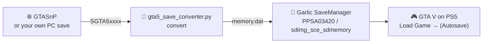
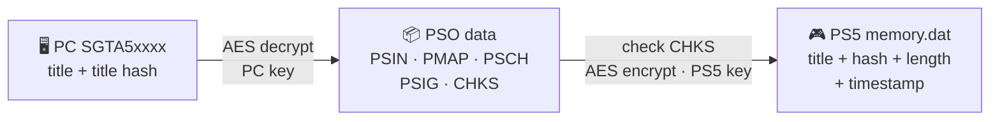

<div align="center">

```text
  ___ _____ _    __   __  ___                  ___                     _
 / __|_   _/_\   \ \ / / / __| __ ___ _____   / __|___ _ ___ _____ _ _| |_ ___ _ _
| (_ | | |/ _ \   \ V /  \__ \/ _` \ V / -_) | (__/ _ \ ' \ V / -_) '_|  _/ -_) '_|
 \___| |_/_/ \_\   \_/   |___/\__,_|\_/\___|  \___\___/_||_\_/\___|_|  \__\___|_|
```

### 🖥️ PC story save &nbsp;➜&nbsp; 🎮 PS5 story save

Take a **GTA V Enhanced PC** story-mode save and load it on a **PS5** with your progress intact.

[](https://www.python.org/)
[](https://www.openssl.org/)
[](gta5_save_converter.py)
<br>
[](#1-get-a-pc-save)
[](#3-put-the-save-on-the-ps5-with-garlic-savemanager)
[](#-tested)
[](#%EF%B8%8F-limitations)

[Quick start](#-quick-start) •
[Tutorial](#-tutorial) •
[Commands](#-commands) •
[How it works](#-how-it-works) •
[Research](RESEARCH.md)

</div>

---

## ⚡ Quick start

```bash
python3 gta5_save_converter.py inspect SGTA50015                # check the PC save
python3 gta5_save_converter.py convert SGTA50015 memory.dat     # convert it
```

Then replace `memory.dat` in the PS5 save **`PPSA03420` → `sdimg_sce_sdmemory`** with Garlic SaveManager, and load the **(Autosave)** in game.



## ✅ Tested

| | PC save | PS5 result |
|---|---|---|
| **Game** | Epic Games Store, Enhanced `1.0.1158.16` | PPSA04264, version `01.010.002` |
| **Save** | `(Autosave) Mr. Richards (38.4%)` | loads as `(Autosave) Mr. Richards (38.4%)` |
| **Progress** | 38.4% | **38.4%**, mission checklist **36/69** ✔ |

## 🧰 Requirements

| | |
|---|---|
| 🐍 **Python** | 3.8 or newer, standard library only |
| 🔐 **openssl** | command-line tool, preinstalled on macOS and most Linux |
| 🎮 **PS5** | jailbroken, with **Garlic SaveManager** or another save manager that can mount saves and replace files in them |
| 💾 **Existing save** | GTA V installed on the PS5 with at least one story-mode save made |

> [!NOTE]
> The PS5 encrypts and signs its own save containers. This tool only produces the game data that goes inside one; your save manager handles the container.

## 📖 Tutorial

### 1. Get a PC save

Use your own (an `SGTA5xxxx` file from your profile folder under `Documents\Rockstar Games\`), or download one from **GTASnP**, sorted by completion:

> 🌐 **https://gtasnp.com/browse/index/gtav_pc/1/save_progress/desc**

1. Pick a save by its **Progress** and **Name** (the name is the last mission).
2. On the save's page, under **Download Save**, pick any slot. **Autosave Slot (Slot 16)** gives `SGTA50015`, **Slot 1** gives `SGTA50000`. The slot only changes the file name; any of them converts to the PS5 autosave.
3. Check the file:

   ```bash
   python3 gta5_save_converter.py inspect SGTA50015
   ```

   You should see `PC save: '<title>'` and `CHKS valid`.

> [!WARNING]
> GTASnP doesn't say whether a save is from **Legacy** or **Enhanced**. If `inspect` says the save *did not decrypt to PSO data*, it's most likely a Legacy save, which isn't supported yet.

### 2. Convert it

```bash
python3 gta5_save_converter.py convert SGTA50015 memory.dat
```

This writes a 1 MiB `memory.dat`. Load Game will show the PC title without its date, for example `(Autosave) Mr. Richards (38.4%)`. To set your own title:

```bash
python3 gta5_save_converter.py convert SGTA50015 memory.dat --title "(Autosave) My save (38.4%)"
```

Check the result: it should print `PS5 save: ...` and `CHKS valid`.

```bash
python3 gta5_save_converter.py inspect memory.dat
```

### 3. Put the save on the PS5 with Garlic SaveManager

1. **Make a story save on the PS5 first** so the save folder exists. Then **close GTA V completely**. If the game is running, it overwrites your file.
2. Start Garlic SaveManager on the PS5 and open its web UI from a computer browser, at the address Garlic shows on the PS5.
3. Under **Browse** → **PS5**, expand GTA V's save folder. It's listed by its save ID, **`PPSA03420`**:

   | Save | What it is |
   |---|---|
   | 🎯 `sdimg_sce_sdmemory` | **the autosave: replace `memory.dat` here** |
   | `sdimg_sce_bu_sce_sdmemory` | backup copy of the autosave |
   | `sdimg_SAVEDATAPROFILE` | game settings, don't touch |
   | `sdimg_SAVEDATASGTA5000x` | manual save slots |

4. 💾 **Back up first:** the `⋮` menu next to `PPSA03420` has **Export All Saves**.
5. Click **`sdimg_sce_sdmemory`** to mount it. You should see `memory.dat` and `sce_sys/`.
6. **Drag and drop your converted `memory.dat` onto the mounted save** and confirm the replace.
7. Unmount the save (**Done**), or select another save.
8. Start GTA V, open **Pause → Game → Load Game** and load the **(Autosave)** entry. If the game asks to overwrite the autosave slot, accept: it re-saves the data in its own PS5 format.

> [!CAUTION]
> **If it didn't work,** you'll see one of these: **"(Backup)"** next to the save's name, a **"Load failed"** message, or the game starting from the **post-prologue state** (Franklin, about 0.8%). Restore your backup.

## 💻 Commands

| Command | What it does |
|---|---|
| `convert <pc save> <out> [--title TEXT]` | PC `SGTA5xxxx` ➜ PS5 `memory.dat` |
| `inspect <save>` | Detects PC or PS5, prints the title (and the timestamp for PS5), checks the title hash and the `CHKS` checksum |

## 🔬 How it works

Both platforms store the same RAGE PSO data. Only the header and the AES key differ.



<details>
<summary><b>Format details</b></summary>

| Offset | PC (`SGTA5xxxx`) | PS5 (`memory.dat`, manual `SGTA5xxxx`) |
|---|---|---|
| `0x000` | u32 BE version = 1 | same |
| `0x004` | title, UTF-16LE, 256 bytes | same |
| `0x104` | u32 BE title hash | same |
| `0x108` | AES-256-ECB data (PC key) | u32 BE encrypted data length (0 in manual slots) |
| `0x10c` | | u64 LE Unix timestamp |
| `0x114` | | AES-256-ECB data (PS5 key) |

- **Title hash:** Jenkins one-at-a-time (joaat) over the 256 title bytes as *signed* chars, seed `0x9DBEE6`.
- **Data:** RAGE PSO blocks `PSIN` → `PMAP` → `PSCH` → `PSIG` → `CHKS`, the same on both platforms.
- **`CHKS`:** `CHKS 00000014 <u32 length> <u32 checksum>`. The checksum is joaat (signed chars, seed `0x3FAC7125`) over the data up to the end of `CHKS`, with the length and checksum fields zeroed.
- The PS5 game reads the newer PC layout through the schema in `PSCH`, and writes it back in its own layout the next time it saves.

</details>

📚 The full story, including the wrong turns and the `eboot.bin` reverse engineering, is in **[RESEARCH.md](RESEARCH.md)**.

## ⚠️ Limitations

- 🌐 **Story mode only.** GTA Online progress is stored on Rockstar's servers.
- 🧪 **Tested combinations only:** PC **Enhanced** saves and one PS5 game version. PC Legacy saves are untested.
- ↩️ **One direction:** PS5 → PC isn't implemented, though the format is symmetrical.
- 💾 **Keep backups.** Not affiliated with Rockstar Games or GTASnP.
